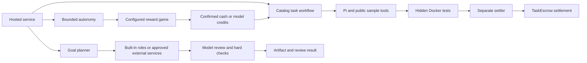

# Tabby architecture

Tabby is Agent economic execution infrastructure for acquiring compute, completing escrow-backed work and paying other services; its hosted arena is the reference application. It has two economic paths: earning from escrow-backed programming tasks, and spending cash on personal goals. Both reuse durable payment journals, but their acceptance and financial outcomes differ. This guide maps the current implementation, including automatic games, external hiring and model downgrade. The [verification guide](VERIFICATION.md) separates Oct 17 public Monad/real-model evidence, Oct 14 controlled local acceptance, and older runs documented against `0526070`. Start with the [review route](REVIEW.md) for a short source/evidence/check sequence.

## Two economic paths

| | Escrow-backed tasks | Cash-funded personal goals |
| --- | --- | --- |
| Hosted actions | `task`, `reward-task`, `metered-task`; `autonomous` runs bounded task/game sessions | `goal` |
| Funding | A publisher has escrowed the reward. Inference uses cash, explicitly authorized task credit, or supported reward credits. Credit pays a whitelisted provider directly. | Every planner, specialist, reviewer and revision call uses `InferCredit.fetch`, `taskId=0`, cash only. |
| Execution | A trusted host selects/accepts a configured catalog task. Pi produces Python and can test public samples. An autonomous parent can acquire USDC or supported model credits through configured games before continuing work. | A model plans 1–3 sequential stages; each receives the original goal and prior outputs. Stages use built-in specialist roles, or independently paid services when external hiring is configured. Optional bounded chain reads provide evidence. |
| Acceptance | Separate Arena runs hidden Docker tests; its separate settler signs the `TaskEscrow.settle` transaction. The host verifies canonical receipts and final task/loan state. | A separate reviewer call checks the final artifact, with deterministic length/date checks enforced by the host. At most one revision and re-review. |
| Financial outcome | Successful settlement deducts the protocol fee, repays an active loan's principal/fee and credits the residue. Failure/expiry follows the contract state machine. Relevant outcomes feed ERC-8004 reputation. | Cash spending and confirmed refunds are recorded. No escrow reward, task loan, repayment or reputation increment is invented. |

The two planners have distinct jobs. [Hosted autonomy](../services/hosted-agents/src/autonomy-executor.ts) reads balances, debt, costs and remaining limits; [Pi autonomy](../packages/pi-loop/src/autonomy.ts) validates `run-task`, `run-game` and `stop` before launching a journaled child. When game acquisition is enabled, trusted runtime resource decisions can bootstrap without paying a planner call or replenish a paused reward-funded task. A game has its own count/spend limits, uses confirmed cash only, and cannot borrow against an expected win. Work resumes only after rewards are confirmed; a pending task retains its original child UUID and escrow acceptance. The [goal commander](../services/hosted-agents/src/goals/commander.ts) decomposes a supplied goal into configured specialist types. Neither planner can add tools, providers, wallet permissions or budgets.

Goal planning, execution and review use separate calls with a persisted route per call. Before a new quote, [goal route selection](../services/hosted-agents/src/goals/executor.ts) reserves capacity for remaining phases and review; [payment admission](../services/hosted-agents/src/goals/payment.ts) can select a cheaper approved route when cash is insufficient for the preferred route plus reserve. Earlier outputs stay in the mission. A signed or unresolved call keeps its original route and payment rather than switching providers. “Independent review” describes the separation of calls and instructions; it does not imply a different model, a separate organization or proof of factual correctness. A reviewed code artifact is not executed by this goal pipeline. The review result must pass the host's hard checks as well; an executor's claim or a stored `completed` stage alone is not a success receipt.

With external hiring enabled, [discovery and ranking](../services/hosted-agents/src/external/registry.ts) inspect the configured directory and each approved service's identity endpoint. Capability, minimum reputation and affordability are admission rules; ranking then weights reputation 70% and price 30%. Configured endpoint, provider, model and price bindings cannot be replaced by an advertisement. Optional ERC-8004 identity/reputation is read at a pinned, rechecked block. [Hiring](../services/hosted-agents/src/external/hiring.ts) binds the assignment, service snapshot, original 402 payment and result provenance. The goal then reviews the returned artifact in a separate call. This is discovery among operator-approved independent services, rather than permissionless recruitment.

## Economic feedback and local execution

[Task admission](ECONOMICS.md) separates affordability from task profit; [accounting](../services/hosted-agents/src/accounting.ts) separates settled income, service cost, borrowing fees, capital and subsidy. The [strategy history reader](../services/hosted-agents/src/strategy-history.ts) binds realized outcomes to their original predictions. The hosted strategy API remains a read-only preview over owner-supplied hypothetical candidates.

The separate [bounded local controller](BOUNDED-ECONOMY.md) supplies an observed candidate path: owned Anvil task state and genuine local provider quotes → frozen deterministic cash policy → fresh preflight → existing `HostedTaskExecutor` → accounting/history → next selection. It defaults to shadow; `--execute-local` enables the isolated business run. This controller is an integration harness, not a new hosted endpoint or deployed autonomous policy. It assumes one wallet writer and a trusted catalog; Unknown blocks new work and preserves the original recovery binding.

The [independent economic Worker](INDEPENDENT-ECONOMY.md) extends this local path with separate publisher/Worker processes, a packed public SDK installation, original HTTP 402 quote handles, durable policy/history, and OS-process interruption recovery. A wallet authority binding and exclusive journal owner prevent cooperating processes from opening another budget. Unknown requires original-payment refund and task closure before continuation. This is an opt-in local example, not a deployed hosted policy.

[Role operating reports](OPERATING-REPORT.md) attribute Agent/platform/supplier contributions and retain unknown costs. [Unified review evidence](REVIEW-REPLAY.md) projects registered saved reports for static replay; its server has no business execution endpoint.

## Payment and inference units

| Service | Purchase and consumption | Source |
| --- | --- | --- |
| Ordinary Relay: goals, task planning, legacy cash calls | One fixed operator quote per call. Actual model/token usage is recorded; it does not change the already paid price. | [Relay](../services/provider-relay/src/relay.ts), [goal payment](../services/hosted-agents/src/goals/payment.ts) |
| External specialist service: configured goal phases | One fixed quote to the selected service's separate provider. Assignment/result provenance and the canonical cash payment are checked before accepting its output. | [External service](../services/hosted-agents/src/external/service.ts), [hire binding](../services/hosted-agents/src/external/hiring.ts) |
| Prepaid inference allowance: `metered-task` | One task-bound package purchase issues credits without calling an LLM. The request digest binds package size and model catalog. The hosted gateway reserves credits before Magpie dispatch and settles them using actual input/output usage at configured rates. | [Allowance relay](../services/provider-relay/src/allowance.ts), [metered adapter](../services/hosted-agents/src/metered-task.ts), [gateway ledger](../services/hosted-agents/src/inference-gateway.ts) |
| Fixed-price solving service B: `task` | One purchase covers a bounded provider-side Pi solve, potentially several model rounds. Early success does not rebate the fixed price; its explicit nondelivery refund rule differs from ordinary Relay. | [Solving relay](../services/provider-relay/src/fixed-price.ts), [solve specification](../packages/pi-loop/FIXED_PRICE.md) |

Token rates consume **microcredits**, package/call prices spend **settlement-asset raw units**, and borrowing creates **principal plus a fee**. These are separate quantities. Monad testnet configuration uses chain `10143` and six-decimal test USDC; local fixtures use Anvil `31337`. Quote budgets exclude native gas and do not establish a supplier invoice. Unused package credits stay bound to their task; they are not transferable tokens or cash.

For a new metered Pi round, [model admission](../services/hosted-agents/src/metered-task.ts) compares the gateway's full credit reserve with available allowance capacity. It can downgrade a planned `strong` round to configured `cheap` only when the cheaper reserve fits and is lower. [The solver](../packages/pi-loop/src/provider.ts) saves the actual tier and keeps prior messages, code and tool results under the same task. An unresolved invocation is recovered before another round; an `Unknown` ledger cannot be bypassed by downgrading. Game-earned model tokens are a separate, supported-model resource, not gateway microcredits or USDC.

[Magpie](magpie-gateway.md) supplies configured physical model routes with implicit retries disabled by the pinned build/patch. It does not underwrite loans or verify task completion. The application's own 402 quote/receipt protocol and SDK perform payment binding; standard x402 scheme/facilitator compatibility has not been established.

## Durable state and recovery

The [hosted service](../services/hosted-agents/src/service.ts) binds the authenticated owner, Agent, UUID and request parameters; the original UUID returns or resumes that run. An unresolved active run retains its budget reservation and blocks a replacement run, with explicit funding subrequests for eligible paused runs. Restart changes interrupted `Queued`/`Running` runs to recoverable `Paused`.

[SessionStore](../packages/pi-loop/src/session.ts) writes atomic, fsynced snapshots under a single local writer lock. Stale locks require explicit recovery after the previous writer stops. This is a single-host design, not a distributed transaction coordinator.

| Boundary | Saved state | Recovery rule |
| --- | --- | --- |
| Accept/payment/settlement | Original identity, quote, `PaymentHandle`, signed transaction bytes/hash and confirmations | Reconcile the same transaction and ID. Do not create another quote or task to escape an unknown result. |
| Ordinary Relay | `Quoted → Paid → Processing → Delivered`; dispatch attempt journal and cached result | A durably delivered response can be read again. An uncertain dispatch remains blocked; only configured explicit rejection responses allow the next saved route. |
| Metered gateway | Grant source, catalog snapshot, invocation ID/digest, credit reservation and response | A completed matching invocation is cached. `DispatchIntent` surviving a crash becomes `Unknown`; `Unknown`/`UsageOverrun` freeze spending. A persisted response can settle without another model call. |
| Personal goal / external hire | Original goal/owner/wallet, approved-route snapshot, selected per-call route, service/assignment binding, deadline, handle, output, review and charges | Reuse the original stage, service and payment. Route selection occurs before a new quote. Stop/deadline does not erase a sent payment; unresolved calls stay paused for reconciliation. |
| Autonomous task / game | Parent limits and decisions, original child UUIDs, pending task and confirmed reward observations | Recover the same child. A reward shortfall can acquire more resources without replacing the already accepted escrow task; an uncertain game/payment must reconcile first. |

Refunds require confirmed chain evidence. An operator may explicitly accept unknown vendor cost under narrow, separately journaled resolution rules; this is not automatic retry or proof of nondelivery. Allowance compensation additionally requires permanent ledger sealing and verification of the original payment/refund before task termination. See [core runtime](core-runtime.md) and [goal reconciliation](../services/hosted-agents/src/goals/reconciliation.ts).

## Trust and custody

The service authenticates a user's login-wallet signature and enforces owner-scoped access. It generates a separate hosted Agent wallet and stores its private key in a restricted local file; the platform controls that signer. This is hosted custody, not a user-held session-key protocol. AgentAccount enforces provider allowlists, policies and freezes; [CreditManager](../contracts/src/CreditManager.sol) relies on the configured underwriter and escrow constraints. Contract administrators retain configured protocol powers.

The Pi model/public-sample tool and the goal models receive no wallet keys, provider API keys or hidden tests. [Arena controller](../services/arena/src/controller.ts) owns hidden-test evaluation but does not load the verifier key; [Arena settler](../services/arena/src/settler.ts) alone owns that key and accepts verdicts over restricted local IPC. This isolates execution from signing while still trusting the configured verifier infrastructure. RPC canonical-block checks bind displayed payment/settlement facts to observed chain state; provider usage and model review remain trusted off-chain inputs.

An external service sees its bounded assignment and prior goal outputs, and receives the configured cash price at its own provider address. It receives no hosted wallet key or authority to increase the mission budget. The operator still chooses trusted execution/payment bindings; advertised ratings and optional chain reputation are selection inputs, not guarantees of output quality.

Optional [chain lookup](../services/hosted-agents/src/goals/chain-lookup.ts) accepts at most two address/transaction targets on supported hosted networks, pins reads to blocks, limits RPC/source data, checks source against deployed bytecode and detects reorgs before saving. Missing or truncated evidence remains unknown. It performs no transaction trace, simulation, general browsing or live yield discovery.

[Public activities](../services/hosted-agents/src/scene-types.ts) are validated, persisted executor events, capped at 256 per run. The [frontend scene projection](../frontend/lib/tabby-scenes.ts) visualizes those events and confirmed results. Animation timing never creates a payment, acceptance or reputation fact.

## Source reading route and scope

Start with [hosted service](../services/hosted-agents/README.md), then the [task workflow and Pi](../packages/pi-loop/README.md) or [goal executor](../services/hosted-agents/src/goals/executor.ts). Follow payment evidence into [Relay](../services/provider-relay/README.md) and [SDK](../packages/sdk/src/index.ts); task settlement ends in [TaskEscrow](../contracts/src/TaskEscrow.sol), [AgentAccount](../contracts/src/AgentAccount.sol), [CreditManager](../contracts/src/CreditManager.sol) and [ERC8004Adapter](../contracts/src/ERC8004Adapter.sol).

Built-in specialists remain internal execution roles. Configured external hiring adds separate service/provider identities without turning every built-in role into a registered Agent. Automatic games acquire supported rewards; free practice games do not issue real rewards. The runtime does not publish arbitrary subtasks, provide arbitrary shell/file/account access for personal goals, offer permissionless expert discovery or a public LP pool, guarantee facts, or coordinate distributed writers. Dated public acceptance does not establish continuous availability. Follow the [Oct 17 public results](monad-hackathon-live-20261017.md), [Oct 14 local paths](autonomous-collaboration-20261014.md) and [verification](VERIFICATION.md) for their source/test/report boundaries.
